# Software Architecture Patterns

This subdirectory contains my notes and resources of the [Udacity Software Architecture Patterns Course](https://www.udacity.com/course/software-architecture-patterns--cd14601).

I drew the diagrams using [Excalidraw](https://excalidraw.com/).

Table of contents:

- [Software Architecture Patterns](#software-architecture-patterns)
  - [Introduction to Software Architecture](#introduction-to-software-architecture)
    - [What is Software Architecture?](#what-is-software-architecture)
      - [Example: Food delivery service architecture, with increasing detail](#example-food-delivery-service-architecture-with-increasing-detail)
    - [Why Design Our Own Software?](#why-design-our-own-software)
      - [Examples of Software Design](#examples-of-software-design)
    - [Architecture Pattern: Monolith](#architecture-pattern-monolith)
    - [Architecture Pattern: MVC = Model-View-Controller](#architecture-pattern-mvc--model-view-controller)
      - [Django's MVC Implementation](#djangos-mvc-implementation)
    - [Architecture Pattern: Layered](#architecture-pattern-layered)
      - [Extra: Domain-Driven Design (DDD) and Onion Architecture](#extra-domain-driven-design-ddd-and-onion-architecture)
    - [Architecture Pattern: Event-Driven](#architecture-pattern-event-driven)
    - [Exercise: Architecture Archetypes](#exercise-architecture-archetypes)
      - [Stage 1: Launch the MVP](#stage-1-launch-the-mvp)
      - [Stage 2: Evolve for Growth](#stage-2-evolve-for-growth)
    - [Summary: Introduction to Software Architecture](#summary-introduction-to-software-architecture)
  - [Communicating Software Architecture](#communicating-software-architecture)
    - [Communicating Software Architecture: Introduction](#communicating-software-architecture-introduction)
    - [Mermaid](#mermaid)
    - [D2: Declarative Diagramming](#d2-declarative-diagramming)
    - [Extra: Excalidraw](#extra-excalidraw)
    - [Communicating Sequences](#communicating-sequences)
    - [Sequence Diagrams: Exercise](#sequence-diagrams-exercise)
    - [Communicating Events](#communicating-events)
  - [Microservices and Modular Design Patterns](#microservices-and-modular-design-patterns)
  - [Cloud-Native Architectural Patterns](#cloud-native-architectural-patterns)
  - [Data and AI Architecture Patterns](#data-and-ai-architecture-patterns)
  - [Distributed Architecture Patterns](#distributed-architecture-patterns)
  - [Project: Real-Time Financial Fraud Detection -- Solution Design](#project-real-time-financial-fraud-detection----solution-design)

## Introduction to Software Architecture

### What is Software Architecture?

- Architectural thinking starts by identifying a system's key components and how they interact.
- We refine a high-level model by adding detail progressively:
  - Identify the actors and external systems: a food delivery platform connects users, drivers, restaurants, and a payment processor.
  - Describe how users access the platform, the functionality it provides, and how it persists data.
  - Specify how requests move between components and how security and performance features, such as rate limiting, work.
- We prioritize architectural characteristics according to the system's needs; for instance:
  - **Banking systems:**
    - **Security:** Protect money and sensitive financial information from unauthorized access.
    - **Availability:** Support around-the-clock operation, subject to specific exceptions.
    - **Integrity:** Keep records correct so payments and withdrawals affect accounts by the intended amounts.
  - **Video streaming services:**
    - **Performance:** Deliver large volumes of video to many users globally. Compression can reduce data volume and improve stream quality; Netflix invests in this area.
    - **Scalability:** Accommodate growing demand, including more replicas, connections, and load.
    - **Ease of use:** Make content easy to find and play across televisions, phones, and tablets, including for young users.
  - **Car control systems:**
    - **Safety:** Use fail-safes that prioritize safety over convenience or performance because malfunctions can cause physical harm.
    - **Real-time responsiveness:** Respond promptly to inputs such as brake-pedal presses; delays can endanger drivers and other road users.
    - **Reliability:** Tolerate real-world inputs and conditions while remaining available and predictable.

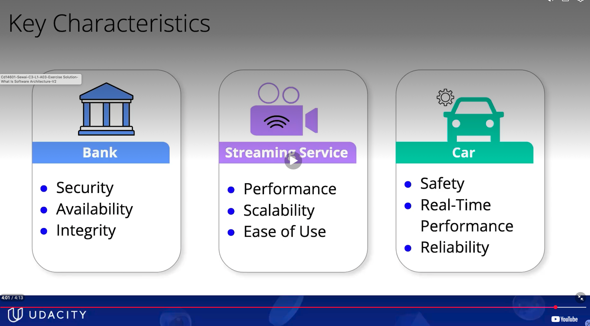

#### Example: Food delivery service architecture, with increasing detail

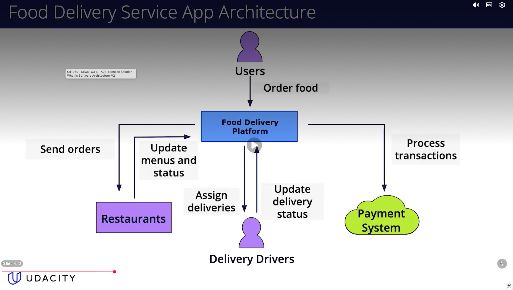


Some components:

- **API gateway:** An entry point for client requests to the platform's API (Application Programming Interface).
  - Routes requests to the appropriate backend service, such as orders or restaurants; if it only does that, it's the same as the **reverse proxy**.
  - However, usually, an API Gateway does more than just routing: it can centralize authentication, logging, and rate limiting.
  - Example: Route `POST /orders` from the customer app to the order service. The service still checks business rules, such as whether the customer may access a particular order.
- **Load balancer:** Distributes incoming traffic across healthy server or service instances to spread work and maintain availability.
  - Example: Distribute order requests among three instances of the order service and stop sending requests to an instance that fails health checks.
  - A gateway manages API routes and policies; a load balancer selects an instance to handle traffic. One product can perform both roles, and their placement depends on the architecture.
- **Payment gateway:** Securely exchanges payment information and authorization requests between the application and payment-processing systems.
  - Example: During checkout, submit a payment request and receive its status before advancing the order's payment workflow.
  - A payment provider may bundle gateway and processing functions. The platform's payment service handles its own business rules and records the payment outcome.
- **Redis cache:** A fast, in-memory store used here to keep temporary copies of frequently requested data and reduce database reads.
  - Example: Check Redis for a restaurant menu; on a cache miss, read it from the database and cache the result.
  - Use expiration through a TTL (Time To Live) and update or invalidate cached entries when necessary. Cached data can become stale; the durable database remains the source of truth in this design.
- **Rate limiter:** Restricts how many requests a caller can make within a time period to control abuse and protect system capacity.
  - Example: Allow an illustrative limit of 100 restaurant-search requests per user per minute, then reject excess requests, commonly with HTTP (Hypertext Transfer Protocol) status `429 Too Many Requests`.
  - It can run in the API gateway or a service and use shared Redis counters so multiple instances enforce a common limit.
- **Core services:** Implement the platform's main business capabilities and rules.
  - Examples include managing users, restaurant menus, orders, payments, and driver assignments.
  - They coordinate state changes and integrations: an order service can check availability, request payment, and arrange delivery. These capabilities may be modules in one application or separately deployed services.
- **Data layer:** Stores and retrieves application data through databases and the code that accesses them.
  - Example: Persist customers, restaurants, orders, and payment references so records survive application restarts.
  - Its design determines how data is queried, kept consistent, and recovered. Cache use complements durable storage.
- **Maps API:** An external interface for mapping capabilities, such as displaying maps, converting addresses to coordinates, or calculating routes and travel times.
  - Example: Locate a delivery address and estimate a driver's journey from the restaurant to the customer.
  - Live driver tracking also requires the driver's app to send location updates; route calculations alone do not supply those updates.
- **Push notification service:** Sends messages from the backend to users' devices through platform delivery systems, including when the app is not open on screen.
  - Example: Notify the customer that an order was accepted or that the driver is approaching.
  - Providers such as Firebase Cloud Messaging deliver messages to registered app instances. Keep order status in the backend so opening the app retrieves the current state independently of a notification.

Component references:

- [API gateways and load balancing (Apache APISIX)](https://apisix.apache.org/learning-center/api-gateway-vs-load-balancer/)
- [Payment gateways (Stripe)](https://stripe.com/resources/more/payment-gateways-101)
- [Redis caching](https://github.com/redis/docs/blob/main/content/develop/use-cases/cache-aside/go/_index.md)
- [Redis rate limiting](https://github.com/redis/docs/blob/main/content/commands/incr.md)
- [Google Maps documentation](https://developers.google.com/maps/documentation/)
- [Firebase Cloud Messaging architecture](https://firebase.google.com/docs/cloud-messaging/fcm-architecture)

Additional resource: [Encoding & Quality (Netflix Research)](https://research.netflix.com/research-area/video-encoding-and-quality) explains Netflix's work on video encoding and quality.

### Why Design Our Own Software?

- Choose an architecture that fits current requirements and can evolve as needs change.
- **Twitter example:** Traffic during the 2010 World Cup exposed scaling limits that adding servers could no longer solve economically. Twitter redesigned its stack and reorganized its engineering teams.
  - Its original design favored a quick launch; needing a redesign later did not make that initial trade-off wrong.
  - **Conway's law:** Systems tend to reflect team structure; architectural changes can also drive team restructuring.
- Make trade-offs deliberately: prioritize reliability for safety-critical systems, rapid iteration for early products, and compatibility and data integrity for legacy rewrites.

Further reading: [New Tweets per second record, and how!](https://blog.x.com/engineering/en_us/a/2013/new-tweets-per-second-record-and-how).

#### Examples of Software Design

- **Nuclear power plant control system:** Prioritize stability, safety, and timely responses; accept higher operating costs to maintain these characteristics.
- **Growing social media app:** Prioritize rapid development, adaptability, and a responsive interface; some reduction in reliability may be acceptable initially.
- **Government agency's legacy system rewrite:** Prioritize backward compatibility and reliability to preserve internal workflows; accept greater development effort.
- Balance competing characteristics according to business needs. Improving one does not always require sacrificing another, but some compromises are necessary.

### Architecture Pattern: Monolith

- **A monolith packages the application's business capabilities into one deployable unit**, typically maintained in a shared codebase.
  - Components within the same process communicate through function calls, avoiding network latency and serialization overhead between those components.
  - A single database is common, but is not a requirement of the pattern.
- **Internal structure still matters:** Organize code into clear modules rather than allowing dependencies to grow ad hoc.
  - A layered structure separates presentation, business logic, and data access.
  - MVC (Model–View–Controller) separates data and domain behavior, presentation, and request handling.
- **Advantages:**
  - Simple deployment and local development help small teams ship features, gather feedback, and iterate quickly.
  - Debugging and tracing requests are easier when the relevant code runs in one process.
  - Operations within one transactional database can maintain consistency without coordinating distributed transactions.
- **Limitations as the system grows:**
  - A faulty component can affect the whole application, and deploying a change requires deploying the application as a unit.
  - Scaling usually replicates the entire application, even when only one feature needs more capacity--for example, a busy product catalog alongside rarely used administration features.
  - Shared code and release schedules can increase coordination costs and limit team independence.
- **Good fit:** Startups validating an idea, small teams with limited resources, and applications that benefit from straightforward transactions.
- **Reconsider the design** when deployments become bottlenecks, components need different scaling strategies, or teams need independent releases. A well-structured monolith can still support substantial scale; growth alone does not require microservices.

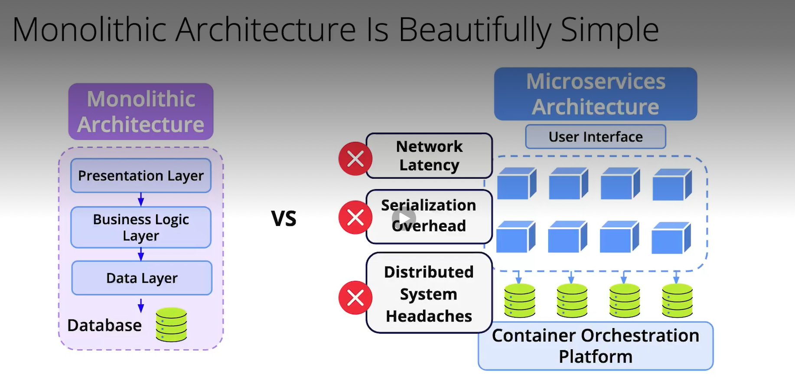

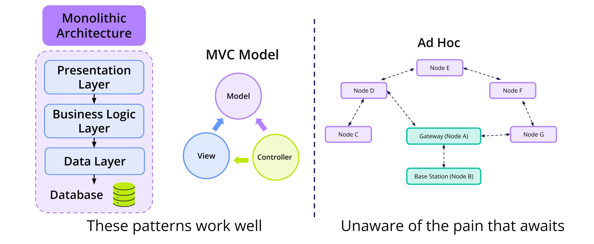

### Architecture Pattern: MVC = Model-View-Controller

- **MVC (Model–View–Controller)** separates responsibilities within an application:
  - **Model:** Represents domain data, behavior, and business rules independently of presentation.
  - **View:** Presents information to the user, such as a page built with HTML (Hypertext Markup Language) and styled with CSS (Cascading Style Sheets).
  - **Controller:** Handles user input, invokes model operations, and selects the view and data to return.
- **Example -- Add to cart:** The controller receives the request, asks the model to update the cart, and supplies the updated data to the view.
- **Benefits:** Clear responsibilities improve testability, support parallel work, and give developers predictable places for code. Web frameworks adapt these ideas with different terminology.
- **Scope:** MVC organizes application code; a monolith describes how the application is packaged and deployed. They can be used together.
- **Communication differs from strict layering:** MVC does not impose an adjacent-layer-only call sequence. Interactions can connect any of its three roles as the MVC variant permits--for example, a controller updates the model, a view reads model state, and model changes notify the view.
  - This flexibility still preserves responsibilities: the model should remain independent of presentation details, and framework conventions may restrict interactions.
  - Strict layered architecture restricts calls to the next lower layer; relaxed layering may allow skipping layers. MVC can itself organize the presentation layer of a larger layered application.
- **Limitations:** Controllers can become bloated and responsibilities can blur. Related presentation patterns include MVP (Model–View–Presenter) and MVVM (Model–View–ViewModel).

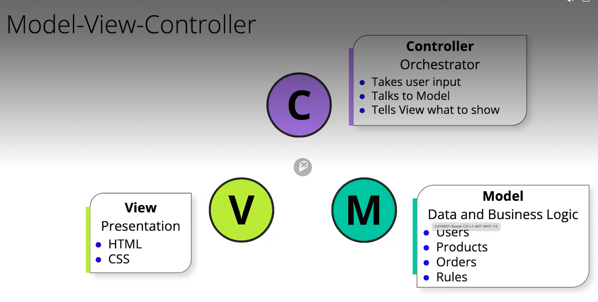

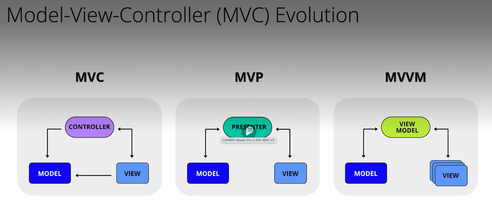

Further reading: [MVC Explained](https://www.tomdalling.com/blog/software-design/model-view-controller-explained/).

#### Django's MVC Implementation

- Django describes its organization as **MTV (Model–Template–View)**. Its names do not map exactly to conventional MVC terminology. [Official explanation](https://docs.djangoproject.com/en/stable/faq/general/#django-appears-to-be-a-mvc-framework-but-you-call-the-controller-the-view-and-the-view-the-template-how-come-you-don-t-use-the-standard-names).

| Responsibility | Django implementation |
| --- | --- |
| Model: data and domain behavior | Classes in `models.py`; the ORM (Object–Relational Mapper) provides database access. |
| Presentation, usually called the MVC view | Templates, commonly under `templates/`, define how the selected data appears. |
| Select data and construct a response | A function or class-based view in `views.py` handles a request and may render a template. |
| Dispatch input to a handler | The framework uses URL (Uniform Resource Locator) patterns in `urls.py` to select a view. Django identifies this routing machinery as its controller. |

- So in comparison to the MVC:

| Traditional MVC | Django |
|---|---|
| Model | Model |
| View | Template |
| Controller | View + framework routing (`urls.py`) |

- For a practical comparison, a Django view performs much of the orchestration commonly assigned to a web MVC controller, while routing is handled by the framework.
- **Example -- Display a restaurant menu:** In an existing Django project, register an app named `menu` in `INSTALLED_APPS`, retain the default app-template discovery, and create the following files. Models define fields and behavior; migrations create the corresponding database structure. [Model documentation](https://docs.djangoproject.com/en/stable/topics/db/models/).

```python
# menu/models.py
from django.db import models


class Dish(models.Model):
    name = models.CharField(max_length=100)
    price = models.DecimalField(max_digits=8, decimal_places=2)
```

```python
# menu/views.py
from django.shortcuts import render

from .models import Dish


def menu_list(request):
    dishes = Dish.objects.order_by("name")
    return render(request, "menu/list.html", {"dishes": dishes})
```

```python
# menu/urls.py
from django.urls import path

from . import views

urlpatterns = [
    path("", views.menu_list, name="menu-list"),
]
```

```python
# Project URL configuration, e.g. config/urls.py
from django.urls import include, path

urlpatterns = [
    path("menu/", include("menu.urls")),
    # Retain other project routes here.
]
```

```html
<!-- menu/templates/menu/list.html -->
<h1>Menu</h1>
<ul>
  
    <li>{{ dish.name }} -- {{ dish.price }}</li>
  
    <li>No dishes available.</li>
  
</ul>
```

```bash
python manage.py makemigrations menu
python manage.py migrate
python manage.py runserver
```

- Open `http://127.0.0.1:8000/menu/`: URL routing selects `menu_list`, the view retrieves dishes through the model, and `render()` combines the template and context into an HTTP (Hypertext Transfer Protocol) response. The template displays the empty message until dishes are added. [Routing, views, and templates tutorial](https://docs.djangoproject.com/en/stable/intro/tutorial03/).
- Keep presentation in templates and reusable business rules outside request handlers. Models can hold domain behavior; more complex workflows can use separate application services.

### Architecture Pattern: Layered

- **Layered architecture** separates code by responsibility:
  - **Presentation:** Handles user interaction and incoming requests.
  - **Business logic:** Executes business operations and enforces rules, such as pricing and order validation.
  - **Data access:** Reads and writes persistent data.
- **Dependency rules:** In strict layering, a layer uses only the layer immediately below it; relaxed layering permits skipping layers. For example, presentation should not bypass business rules by updating the database directly.
- **Layers are logical boundaries; tiers are deployment boundaries.** All three layers can run in one monolith; separate layers do not require separate servers.
- **Benefits:** Clear boundaries support focused testing, team responsibilities, and reuse of business rules across web and mobile interfaces.
  - Hiding database details behind stable interfaces reduces the impact of switching databases, although differences in queries, transactions, and schemas can still require changes.
- **Costs:** Unnecessary pass-through layers add complexity and call or mapping overhead. Network latency arises when calls cross deployment boundaries, not simply because code has layers.
- **Relationship to MVC (Model–View–Controller):** MVC separates interaction and presentation responsibilities; layering defines broader application boundaries. MVC can organize the presentation layer of a layered application.

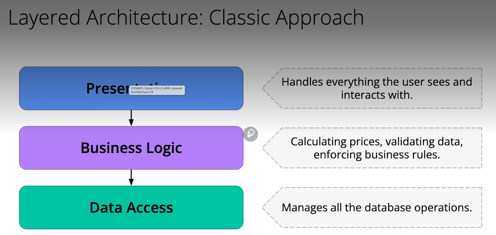

#### Extra: Domain-Driven Design (DDD) and Onion Architecture

- **DDD (Domain-Driven Design):** Model business concepts and rules with domain experts.
  - **Ubiquitous language:** Shared terminology in discussions and code.
  - **Bounded context:** A boundary within which a model applies, such as ordering or delivery.
  - **Domain objects:** Entities have identity; value objects are defined by values; aggregates enforce consistency through a root entity; domain services hold rules that do not belong to one object.
- **Fit with layering:** Each context can separate these responsibilities:

| Layer | Responsibility | Example |
| --- | --- | --- |
| Presentation | Handle input and responses. | Receive an order request. |
| Application | Coordinate the use case. | Load an order, call `accept()`, save it. |
| Domain | Enforce business rules. | Reject acceptance of a cancelled order. |
| Infrastructure | Implement storage and integrations. | Save orders; send notifications. |

- **Onion architecture:** Source-code dependencies point inward toward the domain. Inner layers define interfaces; infrastructure implements them, keeping business rules independent of databases and frameworks. Runtime calls can still reach outward through those interfaces.
- **Use when business rules are complex:** DDD shapes the model; Onion protects it from technical details. Both work within a monolith and do not require microservices.

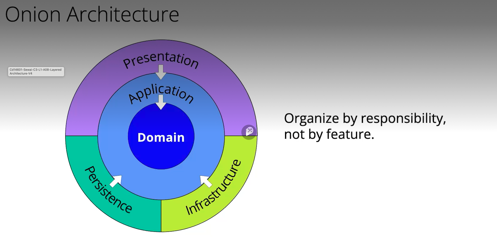

References:

- [Bounded contexts](https://martinfowler.com/bliki/BoundedContext.html)
- [DDD layers](https://learn.microsoft.com/en-us/dotnet/architecture/microservices/microservice-ddd-cqrs-patterns/ddd-oriented-microservice)
- [Domain model patterns](https://learn.microsoft.com/en-us/dotnet/architecture/microservices/microservice-ddd-cqrs-patterns/microservice-domain-model)
- [Onion/Clean architecture](https://learn.microsoft.com/en-us/dotnet/architecture/modern-web-apps-azure/common-web-application-architectures).

### Architecture Pattern: Event-Driven

- **Event-driven architecture:** Components publish events describing what happened, such as `OrderReceived` or `PaymentFailed`; interested consumers react to them.
  - In **publish–subscribe**, publishers send events through an event channel or broker without calling each subscriber directly.
  - Consumers typically process events asynchronously; the publisher does not wait for their business operations to finish.
- **Example -- Checkout:**
  - With synchronous request–response, checkout waits for payment, inventory, and shipping calls; a slow or unavailable dependency can delay the response.
  - With events, checkout records the order, publishes `OrderReceived`, and acknowledges that processing has started. Payment, inventory, notifications, and analytics react as the workflow progresses.
  - Acknowledging receipt does not mean payment succeeded or delivery is confirmed; dependent steps still need coordination.
- **Benefits:**
  - Loose coupling lets consumers evolve and scale independently.
  - New subscribers, such as fraud detection or marketing services, can react to existing events without changing publisher logic, provided those events contain the information they need.
  - Fits workflows spanning multiple systems or teams.
- **Trade-offs:**
  - **Eventual consistency:** Updates happen at different times; an accepted order may appear before inventory is updated.
  - **Harder tracing:** A workflow crosses handlers and services, so logs must be correlated rather than followed through one call stack.
  - **Failure propagation:** Invalid events or faulty consumers can disrupt downstream processing; asynchronous communication still requires error handling.
- **Fit with other patterns:** A monolith or layered application can also use events. Deployment structure, code organization, and communication style are separate design choices.
- **Use when** asynchronous workflows and loose coupling justify the additional coordination and operational complexity.

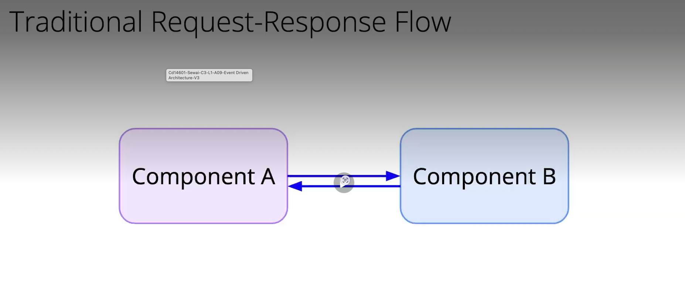

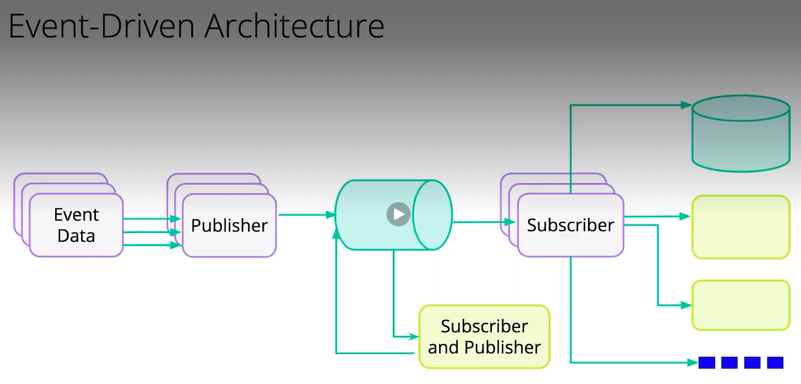

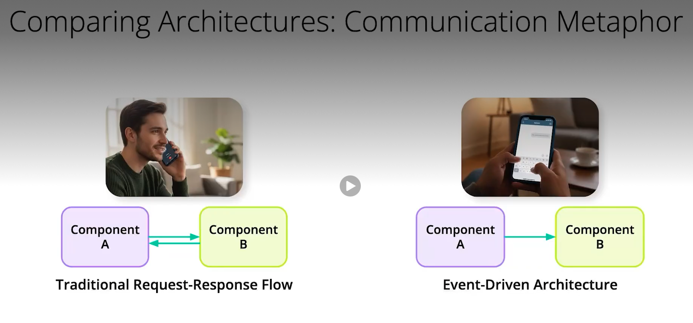

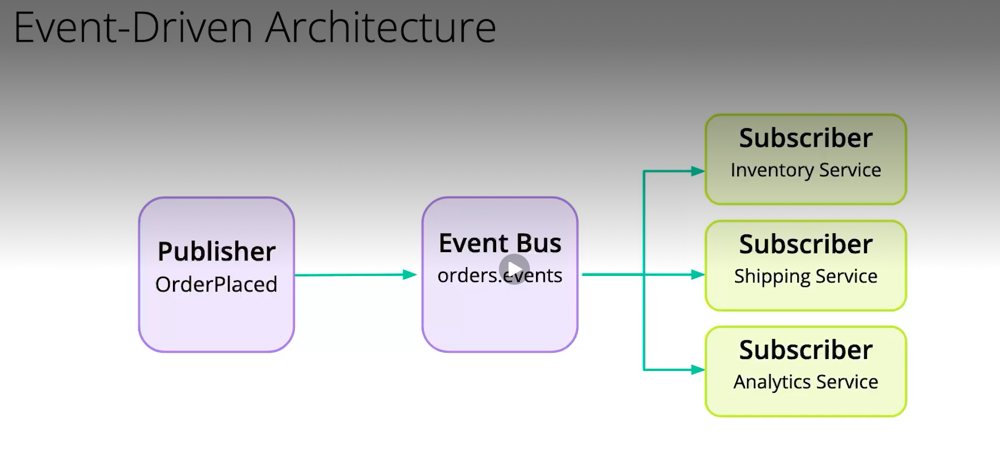

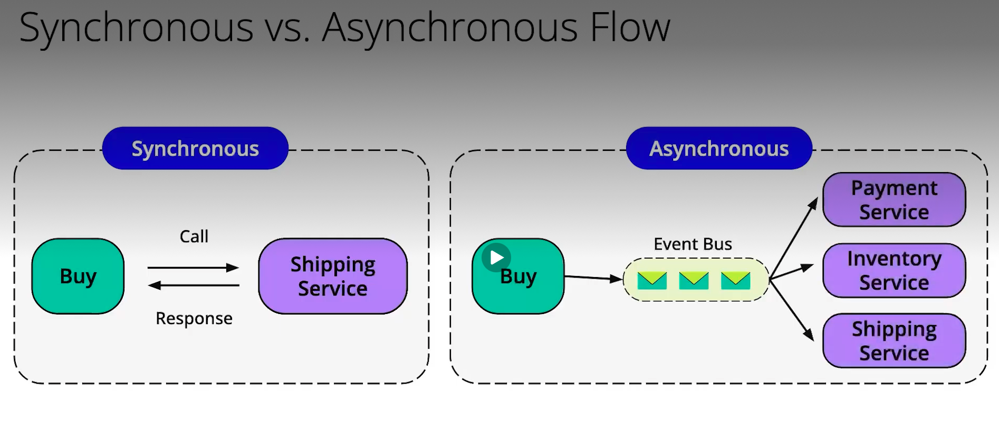

Further reading: [Event-Driven Architecture -- AWS](https://aws.amazon.com/event-driven-architecture/).

### Exercise: Architecture Archetypes

- **Scenario:** EcoDweller Solutions is building a SHEMS (Smart Home Energy Management System) to help homeowners monitor and optimize energy use. Architecture should evolve with its business needs.

#### Stage 1: Launch the MVP

- **Goal:** A small team with limited funding needs to launch an MVP (Minimum Viable Product) quickly and validate it with early adopters.
- **Requirements:** Ingest real-time readings from one smart-meter model, display historical consumption in a basic web dashboard, and manually switch a smart plug on or off.
- **Proposed architecture:** A monolith handles web requests, authentication, ingestion, dashboard rendering, and device communication; an external database persists the data.
  - **Advantage:** One application simplifies development and deployment, helping the team launch and iterate quickly.
  - **Future risk:** Coupled releases, shared failures, and scaling the whole application can become constraints as usage and features grow.

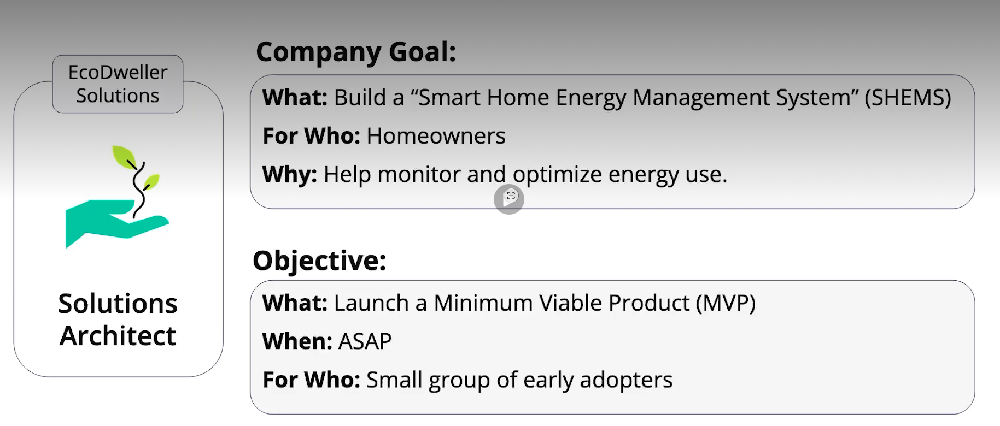

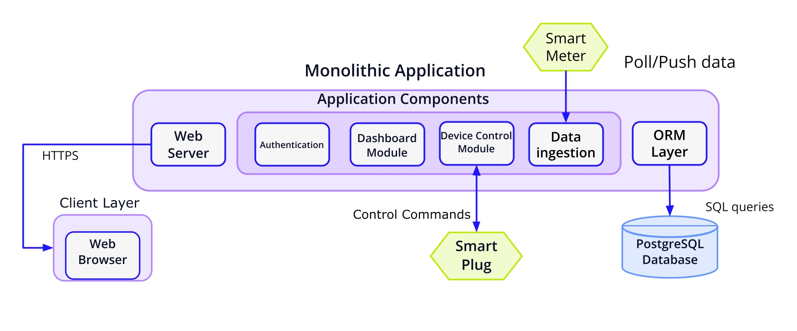

#### Stage 2: Evolve for Growth

- **Context:** Funding, users, and team size have increased; deployments are slowing and bugs can affect the whole application.
- **New requirements:** Consumption-threshold alerts, scheduled device actions, support for two additional device types such as thermostats and solar inverters, and greater resilience to component failures.
- **Proposed evolution:** Extract ingestion and alerting into separate services, connected through a message queue for asynchronous event handling.
  - Extend ingestion for the new device types; retain and extend scheduling and device control in the core application.
  - Keep authentication and other capabilities in the monolith rather than splitting every feature into a service.
  - **Advantage:** Ingestion and alerting can be maintained and deployed independently. Asynchronous processing reduces direct availability dependencies, provided failures and queued work are handled correctly.
  - **Trade-off:** More services and a queue introduce operational overhead, harder tracing, and a need to manage retries, duplicate messages, and delayed processing.
- **Decision principle:** Make incremental changes that address current requirements. Other designs are valid if their benefits and trade-offs can be justified; a complete microservices or event-driven migration is not required.

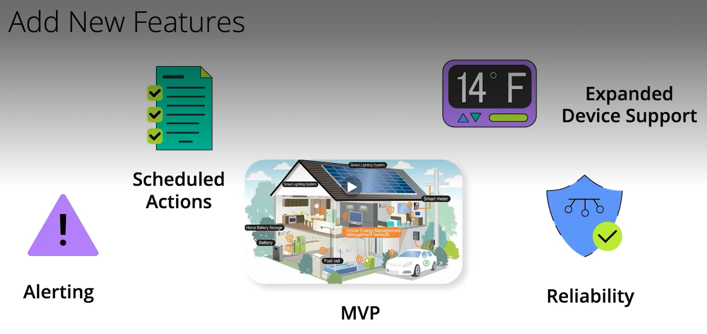

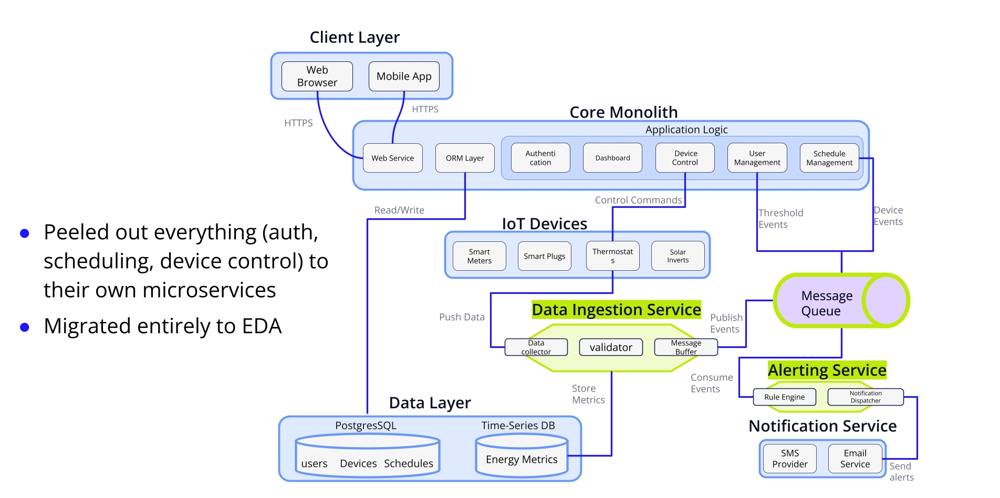

### Summary: Introduction to Software Architecture

- **Monolith:** A single deployable application keeps development and operations simple, making it a useful starting point for small teams validating an idea.
- **MVC (Model–View–Controller):** Separates domain data and behavior, presentation, and input handling within an application.
- **Layered architecture:** Establishes boundaries between presentation, business logic, and data access to improve maintainability as complexity grows.
- **Event-driven architecture:** Decouples components through events and asynchronous processing, supporting integrations and independent scaling while complicating debugging and consistency.
- **Choose and combine patterns according to current needs:** They address different concerns and can coexist. Added architectural complexity should solve a concrete problem.
- **Document trade-offs and revisit decisions:** A suitable design today may need to evolve as requirements, team size, and operational demands change.

[Video: Summary of Introduction to Software Architecture](https://www.youtube.com/watch?v=04rEKcoSH3I)


## Communicating Software Architecture

### Communicating Software Architecture: Introduction

- **Effective communication makes architectural decisions usable.** Teams must understand decisions to implement and maintain the system correctly.
  - Explain the purpose of each component and the problem it solves.
  - Be clear about complexity and trade-offs.
- **Adapt the explanation to the audience.** The same system needs different levels of detail and focus.
  - **Technical teams:** Implementation details, authentication flows, error handling, database schemas, and dependencies.
    - **Online store example:** An API (Application Programming Interface) gateway leads to REST (Representational State Transfer) endpoints using Spring MVC (Model-View-Controller) and a GraphQL interface.
      - An order facade orchestrates validation, pricing, inventory, and payments.
      - Data access uses REST or gRPC (gRPC Remote Procedure Call) clients, a JPA (Jakarta Persistence API)/Hibernate repository, and an event publisher.
      - Dependencies include user, product inventory, and payment microservices, plus external payment, tax, and shipping services.
      - PostgreSQL stores data, Redis provides caching, and Kafka carries events.
  - **Business stakeholders:** Business value, user journeys, and system capabilities.
  - **Operations teams:** Operational impact, failure modes, and scaling characteristics.
    - **Online store example:** Web, mobile, administrator, and vendor interfaces connect through an API gateway.
      - Core services handle users, products, orders, inventory, carts, and search.
      - Infrastructure includes a message queue, analytics pipeline, monitoring, logging, and a CDN (Content Delivery Network).
      - Data stores include user, order, and product databases, a session cache, a search index, and image storage.
- **Choose diagrams according to the question being answered.**
  - **Sequence diagrams:** Show synchronous interactions step by step, such as a user action triggering connection checks, asset loading, and dependency calls.
    - Event-driven flows with multiple consumers can become difficult to follow in this format.
  - **Data flow or event flow diagrams:** Show how information moves asynchronously between decoupled components.
    - Example: An occupancy sensor publishes data through an event bus to multiple consumers.
  - **Solution architecture diagrams:** Show the overall system, major components, data sources and destinations, and external dependencies.
    - Useful for executive briefings and onboarding new team members.
- **Choose diagramming tools that fit the workflow.**
  - **Visual tools:** Visio suits Microsoft environments, Miro supports collaborative whiteboarding, and draw.io provides a free browser-based option.
    - Useful for quick sketches, real-time collaboration, and presentation-ready diagrams.
  - **Diagram as code:** Mermaid and D2 express diagrams as plain text and generate consistent visuals.
    - Update diagrams by editing text stored alongside code; Git history tracks architectural changes.
    - Generate documentation diagrams through CI/CD (Continuous Integration/Continuous Delivery) pipelines to keep them aligned with the system.

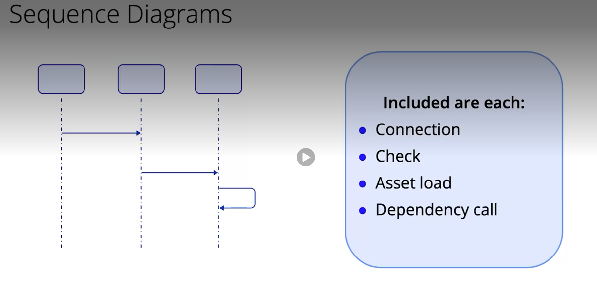

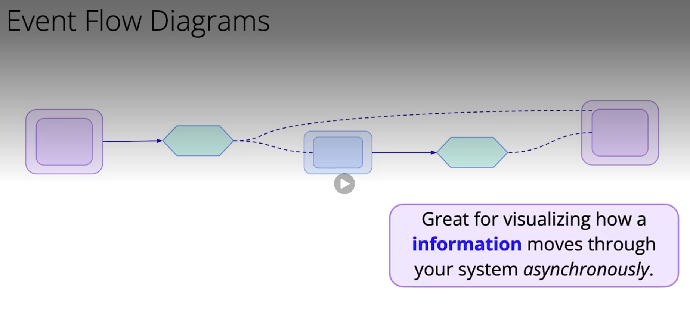

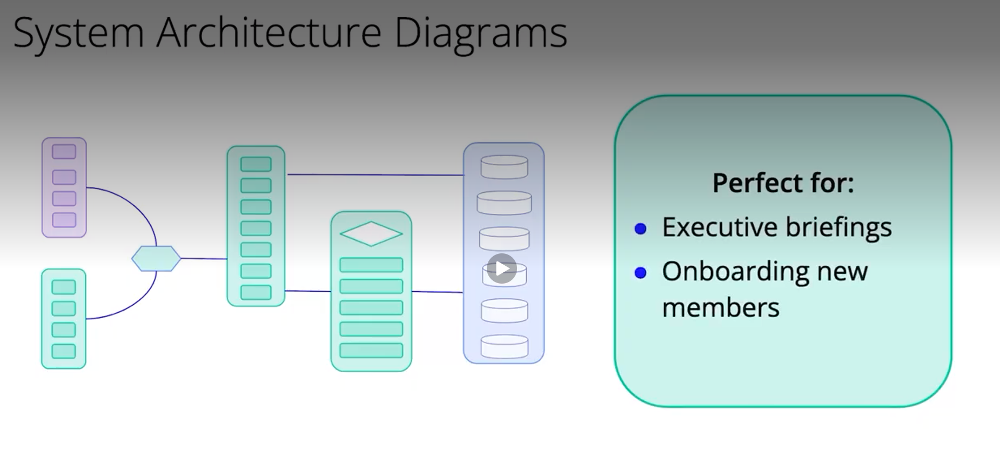

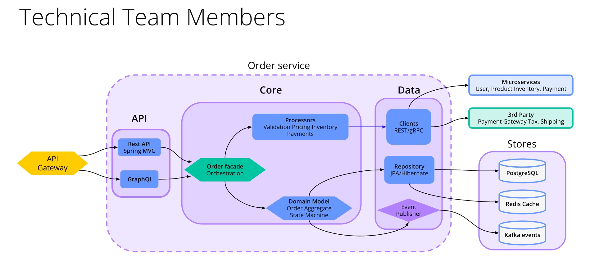

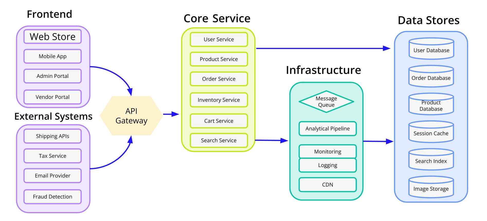

### Mermaid

- **Mermaid creates diagrams from human-readable plain text.** Its syntax remains understandable without rendering.
  - Keep diagram source in Markdown documentation alongside application code.
  - Track changes in version control and review them in pull requests.
  - Embedded source avoids separate binary diagram files, missing originals, and broken links to exported diagrams.
- **Each diagram type has its own syntax with consistent patterns.**
  - **Flowcharts:** `A --> B` connects two nodes.
  - **Sequence diagrams:** `Alice->>Bob: Hello` sends a labeled message.
  - **Class diagrams:** `Vehicle <|-- Car` indicates that `Car` inherits from `Vehicle`.
- **Use a text editor or IDE (Integrated Development Environment) to write diagrams.** A browser or editor plugin is optional for previewing them.
  - The [Mermaid Live Editor](https://mermaid.live/) provides live previews while editing.
  - Embed diagrams in fenced `mermaid` code blocks for supported Markdown renderers, including GitHub, GitLab, Notion, and documentation sites.
  - IDEs such as Visual Studio Code may need an extension; Markdown support alone does not guarantee Mermaid rendering.
  - Rendered diagrams can use SVG (Scalable Vector Graphics).
- **Mermaid prioritizes simplicity and Markdown integration over visual polish.** Try it alongside the next diagramming tool to compare their fit for your workflow.
- **Example: Remotely change an HVAC (Heating, Ventilation, and Air Conditioning) system's temperature.**
  - `flowchart LR` sets a left-to-right layout; square brackets define actions, braces define decisions, and labeled arrows distinguish outcomes.
  - The diagram below shows validation, authorization, availability checks, command execution, and the final user message.

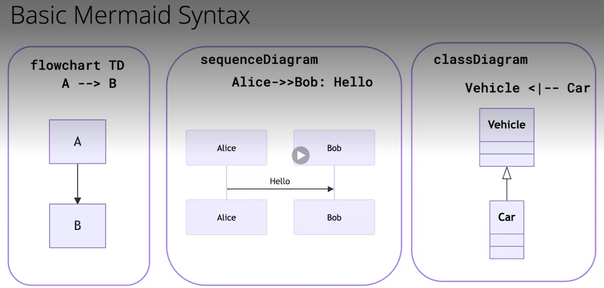

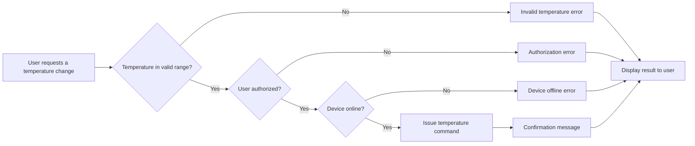

### D2: Declarative Diagramming

- **D2 (Declarative Diagramming) creates diagrams from text, emphasizing expressiveness and visual polish.**
  - Suitable for publication-quality architecture documentation and executive presentations.
  - Source files remain version controlled alongside code.
  - Offers more styling control than simpler tools, with a steeper learning curve; start with boxes and arrows and refine them incrementally.
- **Use a text editor and the standalone D2 command-line tool.** See the [installation guide](https://d2lang.com/tour/install/) for platform-specific instructions.
  - Installation options include Homebrew on macOS, the shell installer on Linux, Scoop on Windows, and building from source with Go.
  - Verify installation with `d2 --version`.
  - Save source as `diagram.d2` and render it to SVG (Scalable Vector Graphics), PNG (Portable Network Graphics), or PDF (Portable Document Format).
  - Use `--watch` to regenerate diagrams as source changes.
  - Integrate rendering into CI/CD (Continuous Integration/Continuous Delivery) pipelines and static documentation sites.
- **Describe structure and appearance declaratively.**
  - Connections use `frontend -> backend`; add text after a colon to label components or interactions.
  - Curly braces group related components into nested containers.
  - Properties control shapes, fill and stroke colors, fonts, icons, and themes.
  - Images can come from remote HTTP (Hypertext Transfer Protocol) URLs or local files, including SVG assets mixed with built-in shapes.
  - Grids arrange components into rows or columns, with placement inferred from the declared structure and constraints.
- **Select a layout engine with `--layout`.** Available features depend on the engine.
  - **Dagre:** Free, default engine for directed, hierarchical layouts.
  - **ELK:** Free alternative for directed graph layouts.
  - **TALA:** Proprietary Terrastruct engine installed separately, designed for software architecture diagrams.
    - Supports explicit `top` and `left` coordinates to fix object positions while arranging other elements around them.
- **Example: An API (Application Programming Interface) gateway routes requests to backend services.** The examples below show labeled connections and component styling in D2 and Mermaid.

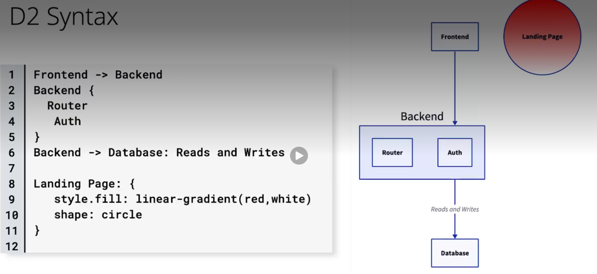

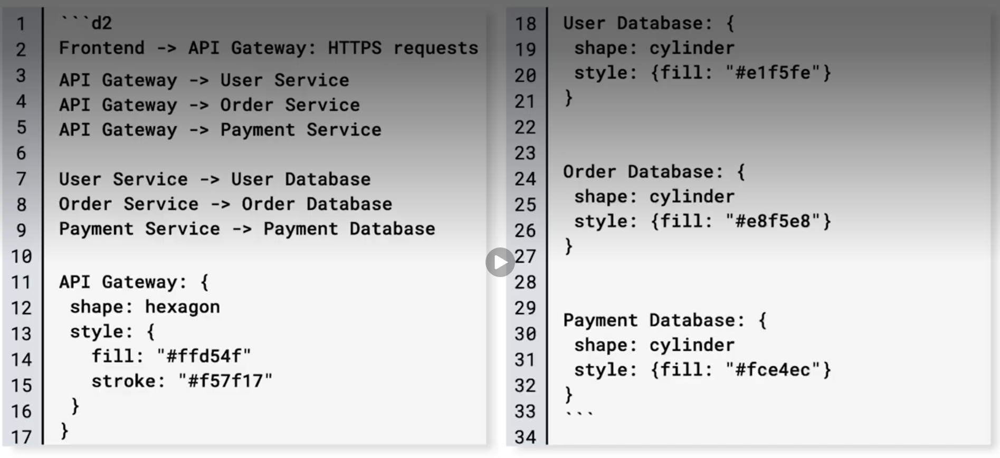

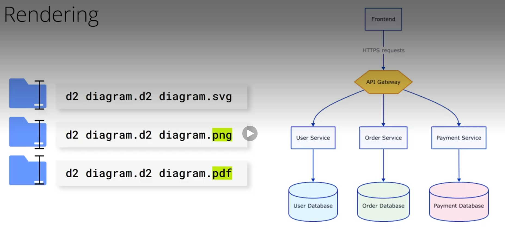

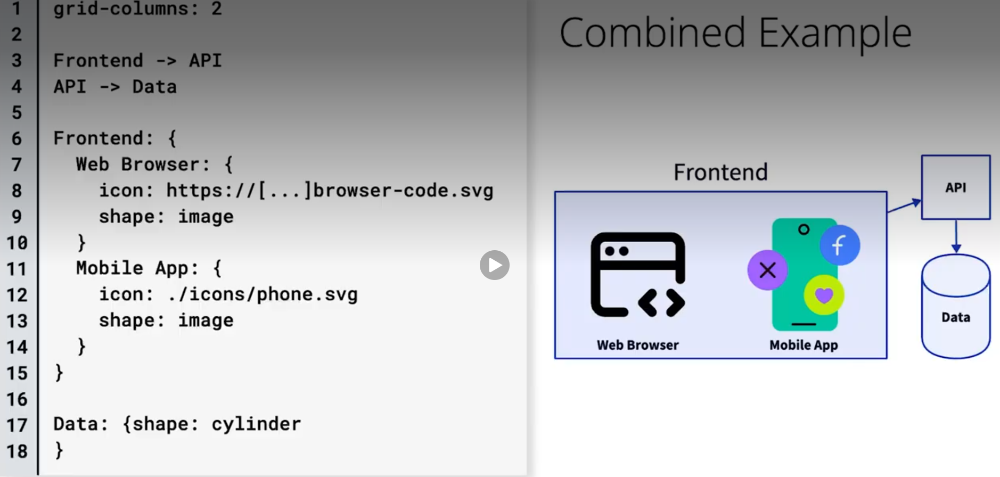

Installation alternatives; choose the command for your environment:

```sh
# macOS with Homebrew
brew install d2
# Linux with the shell installer
curl -fsSL https://d2lang.com/install.sh | sh -s --
# Windows with Scoop
scoop install d2
# From source (requires Go)
go install github.com/d2lang/d2@latest
```

Save this D2 example as `diagram.d2`:

```d2
direction: right
client: Client
gateway: API Gateway {
  shape: hexagon
  style.fill: "#dbeafe"
  style.stroke: "#2563eb"
}
services: Backend services {
  users: User Service
  orders: Order Service
}
client -> gateway: Request
gateway -> services.users: User requests
gateway -> services.orders: Order requests
```

```sh
d2 --version
d2 diagram.d2 diagram.svg
d2 diagram.d2 diagram.png
d2 diagram.d2 diagram.pdf
d2 --layout elk diagram.d2 diagram.svg
d2 --watch diagram.d2 diagram.svg
```

Equivalent Mermaid example for Markdown rendering:

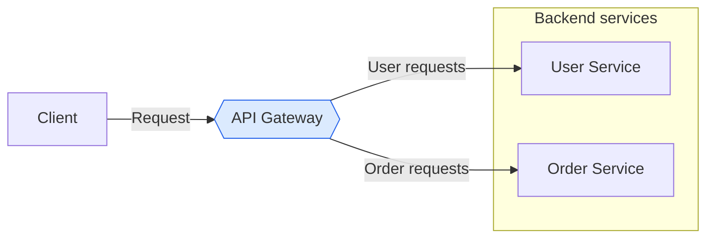

### Extra: Excalidraw

- **Excalidraw is a visual whiteboard for sketching diagrams with a hand-drawn appearance.** Use it for architecture discussions, component overviews, and early design ideas.
- **Install the VS Code (Visual Studio Code) extension.**
  - Open Extensions with `Ctrl+Shift+X`, search for **Excalidraw**, and install the extension with identifier `pomdtr.excalidraw-editor` ([Marketplace listing](https://marketplace.visualstudio.com/items?itemName=pomdtr.excalidraw-editor)).
- **Create a drawing inside the repository.**
  - In Explorer, create an empty file such as `assets/order-flow.excalidraw` and open it.
  - The extension opens an interactive canvas; if another editor opens, right-click the file and use **Open With...** to select Excalidraw.
  - Use rectangles for services, diamonds for decisions, arrows for interactions, and text for labels.
  - Example: Draw `Client --> API Gateway --> Order Service`, then connect the order service to a database.
  - Select elements to adjust colors, borders, and text; group related components to keep the diagram readable.
  - Save with `Ctrl+S` and commit the drawing with the documentation it explains.
- **Choose a format according to how the drawing will be used.**
  - `.excalidraw` is the native file format and stores editable scene data as JSON (JavaScript Object Notation).
  - For a straightforward workflow, keep this source file and use the canvas export menu to export a separate `.svg` or `.png` image for documentation.
  - After changing the source drawing, export the image again and commit both files.
  - Alternatively, the VS Code extension supports `.excalidraw.svg` and `.excalidraw.png`: images with embedded scene data that remain editable, combining source and documentation image in one file.
  - Prefer SVG (Scalable Vector Graphics) for sharp diagrams at different sizes; use PNG (Portable Network Graphics) when a raster image is needed.
  - The editor toolbar lets you switch between the canvas and the underlying text or image.
  - Arbitrary SVG or PNG images do not become editable Excalidraw scenes simply by renaming them; they need embedded scene data.
- **Embed the exported image in Markdown using a relative path.** The example below assumes the drawing is in `assets` beside the README.

```markdown

```

Extension reference: [Excalidraw for VS Code](https://github.com/excalidraw/excalidraw-vscode).

### Communicating Sequences

- **Sequence diagrams show behavior unfolding over time:** who interacts, in what order, and with which messages.
  - Vertical lifelines represent participants; horizontal arrows represent interactions.
  - Time progresses from top to bottom, revealing the order of operations.
- **Use them to explain request-response behavior, especially when components wait for replies before continuing.**
  - **API (Application Programming Interface) flows:** Trace authentication, validation, business logic, and data persistence.
  - **User journeys:** Follow a user action across components, such as a button click loading a video from the browser through backend systems to a device and back.
  - **Error handling:** Document authentication failures, invalid inputs, and timeouts alongside the successful path.
  - For asynchronous, event-driven architectures, data flow or event flow diagrams often communicate the overall behavior more clearly.
- **Keep diagrams focused and readable.**
  - Show architecturally significant interactions across component boundaries rather than every method call.
  - Use clear, consistent participant names, such as `User Service` instead of `US` or `Service 1`.
  - Annotate timing constraints, including timeouts, to explain behavior under load.
  - Group related steps with frames or notes; Mermaid's `alt` / `else` blocks express alternative outcomes.
- **Mermaid and D2 both support sequence diagrams.**
  - **Mermaid example below:** A user controls an HVAC (Heating, Ventilation, and Air Conditioning) device through a gateway and central server.
    - JWT means JSON Web Token; HTTP means Hypertext Transfer Protocol.
    - The success response confirms that the temperature change was initiated, rather than that the room reached the requested temperature.
    - `participant ... as ...` defines readable labels; `->>` shows calls, `-->>` shows replies, and `CS->>CS` represents internal validation.
  - **D2 example image:** A mobile app requests a profile through a gateway; an authentication service validates the token against user data and permissions before profile retrieval through a profile service and database. Responses return toward the app.

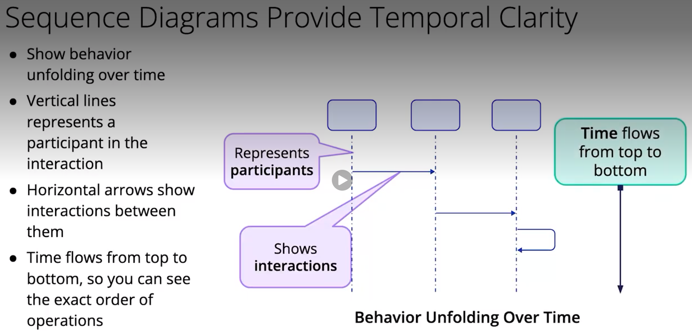

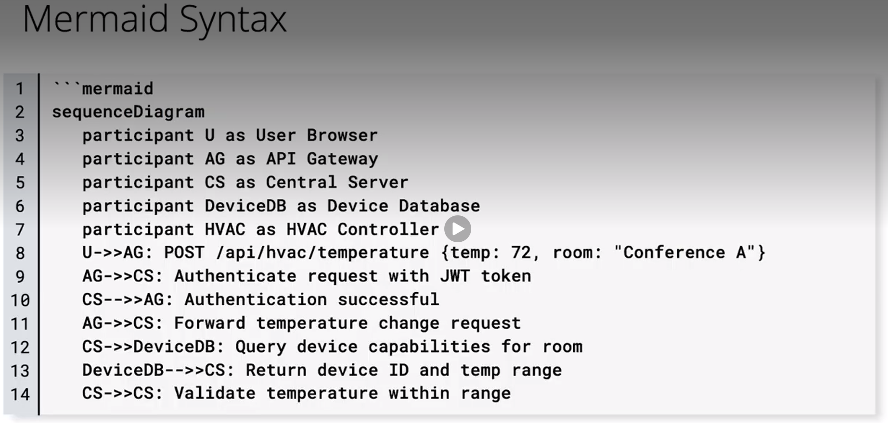

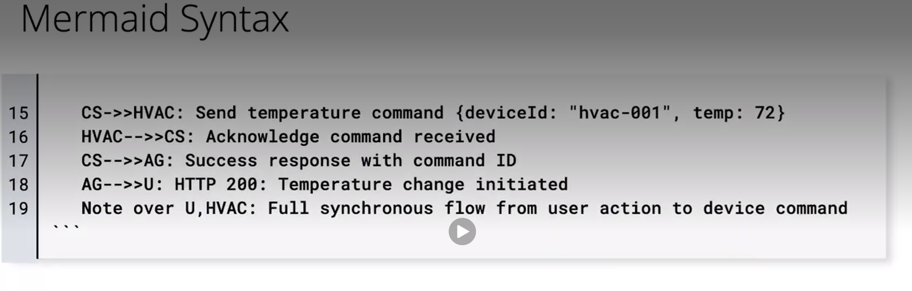

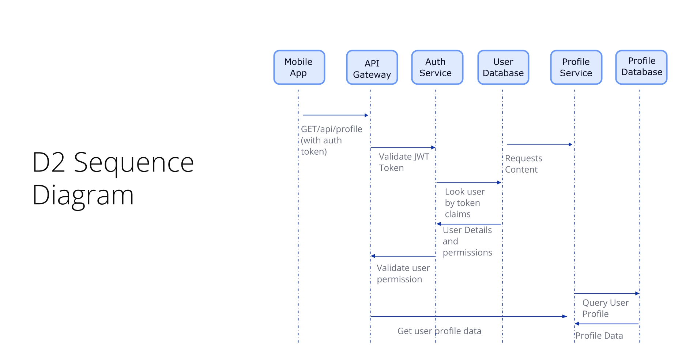

Mermaid example transcribed from the two syntax images:

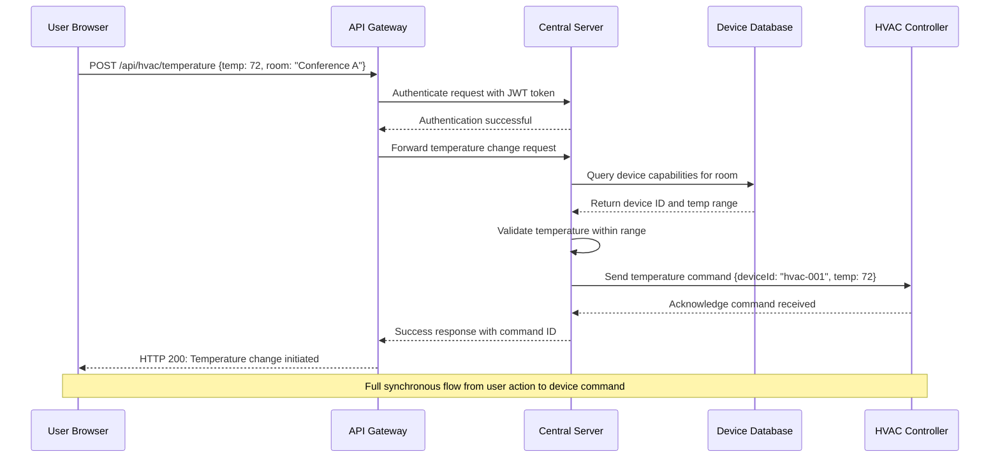

### Sequence Diagrams: Exercise

- **Task:** Model a registered, logged-in user turning on an exterior door's magnetic lock through a web dashboard in a centralized security and HVAC (Heating, Ventilation, and Air Conditioning) system.
  - Show the synchronous request-response sequence from the user's click to the final response.
  - Prioritize clarity and accuracy; use Mermaid, D2, draw.io, or another graphical editor.
  - Deliver an image, such as PNG (Portable Network Graphics) or SVG (Scalable Vector Graphics), or a text file containing the diagram definition.
- **Required participants and responsibilities:**
  - **User's Browser:** Starts the interaction.
  - **API (Application Programming Interface) Gateway:** Provides the single entry point for client requests and forwards authentication information in a header.
  - **Central Server:** Verifies the user's session and permission to control the door before issuing a device command.
  - **Maglock Device:** Executes the command and reports its status.
- **Solution:** The diagram below shows the successful path, with session and authorization checks preceding the lock command and the resulting status returning through the server and gateway to the browser.
  - HTTP means Hypertext Transfer Protocol; `200` indicates a successful response.

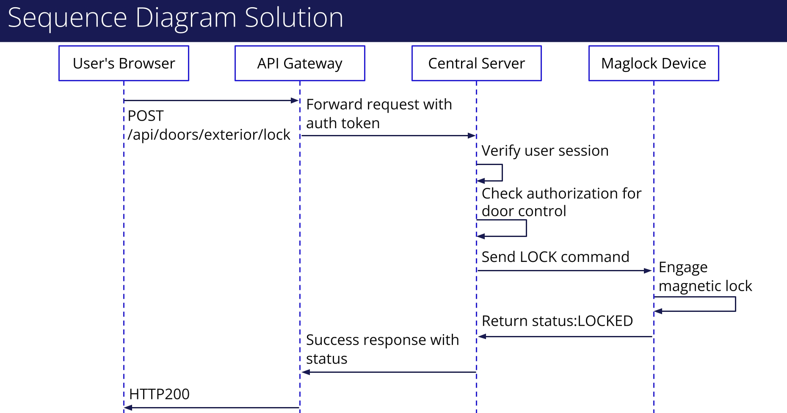

Mermaid equivalent of the solution image:

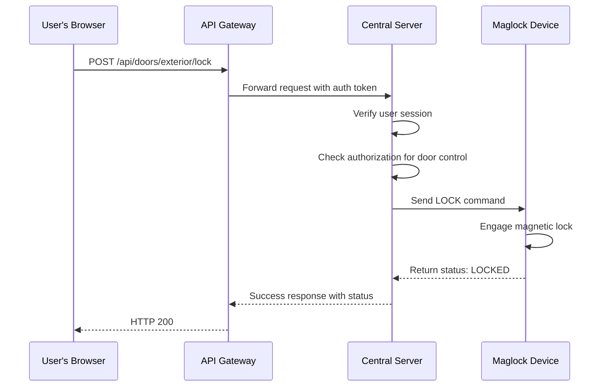

### Communicating Events

- **Event flow diagrams map asynchronous data journeys:** producers publish events, and consumers process them independently, potentially at different times and speeds.
  - Emphasize loose coupling and parallel processing rather than a synchronous conversation in which each component waits for a reply.
  - Independent consumers can isolate failures so one consumer's failure need not stop the others.
- **Use event flow diagrams for:**
  - Publish-subscribe microservices, stream processing, and reactive architectures.
  - Background processing: A file upload triggers virus scanning, thumbnail generation, metadata extraction, and storage concurrently.
  - Messaging infrastructure: Show producers, brokers, topics or queues, and consumers; examples include RabbitMQ, Apache Kafka, AWS (Amazon Web Services) SNS (Simple Notification Service), and SQS (Simple Queue Service).
  - IoT (Internet of Things) networks: Trace sensor readings through ingestion, analytics, and business rules to resulting actions.
    - Example: A temperature event independently triggers HVAC (Heating, Ventilation, and Air Conditioning) adjustments, logging, alerting, and analytics.
- **Make the event relationships explicit.**
  - Label event types meaningfully and show their sources and flow direction; event direction can differ from the order of business-process steps.
  - Group related consumers and show feedback loops where a consumer publishes a new event.
  - Show communication through the event bus without implying direct calls or synchronous waits between services.
- **Common patterns:**
  - **Fan-out:** One event reaches multiple consumers, such as notification, logging, and analytics services.
    - The order example distributes events to inventory, payment, shipping, email, fulfillment, analytics, and audit services.
    - Inventory, payment, and shipping also publish events back to the stream; the diagram connects fulfillment to a customer and analytics to a warehouse system.
  - **Event sourcing:** Persist the history of state-changing events as the source of truth and derive current state by replaying them.
    - Useful for audit trails and complex business processes; an event stream alone does not establish event sourcing without an authoritative event store ([reference](https://learn.microsoft.com/en-us/azure/architecture/patterns/event-sourcing)).
  - **Saga:** Coordinate a long-running business process across services through local steps and subsequent events or commands.
    - Compensating actions address completed steps when the workflow fails, helping restore business consistency ([reference](https://learn.microsoft.com/en-us/azure/architecture/patterns/saga)).
  - **CQRS (Command Query Responsibility Segregation):** Separate responsibilities for state-changing commands and data-reading queries.
- **Distinguish workflow coordination from message transport.**
  - **Orchestration:** A central controller directs workflow steps and handles outcomes.
  - **Choreography:** Services react to relevant events and publish their own outcomes without a central workflow controller.
    - Useful across bounded contexts, where each domain boundary should require minimal knowledge of other services.
    - Example: The order service publishes `OrderPlaced`; inventory reacts and publishes `InventoryReserved`; shipping consumes the relevant order and inventory events.
  - A central broker can support either approach; its presence alone does not imply orchestration, despite the labels in the example images ([reference](https://learn.microsoft.com/en-us/azure/architecture/patterns/choreography)).

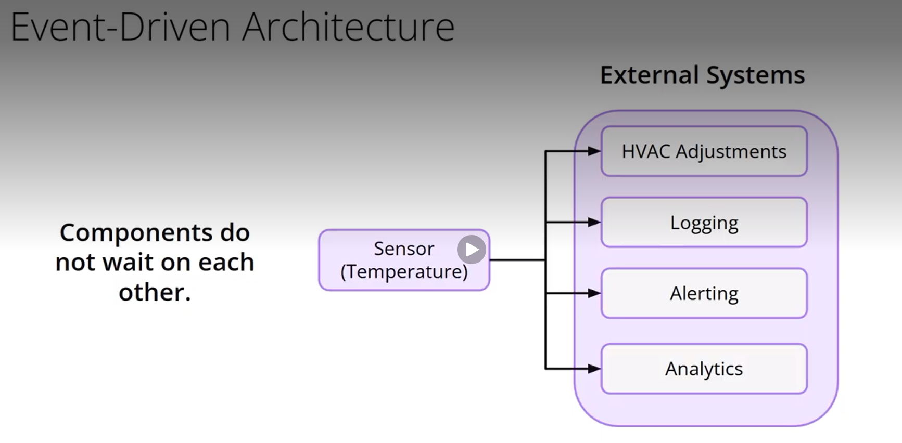

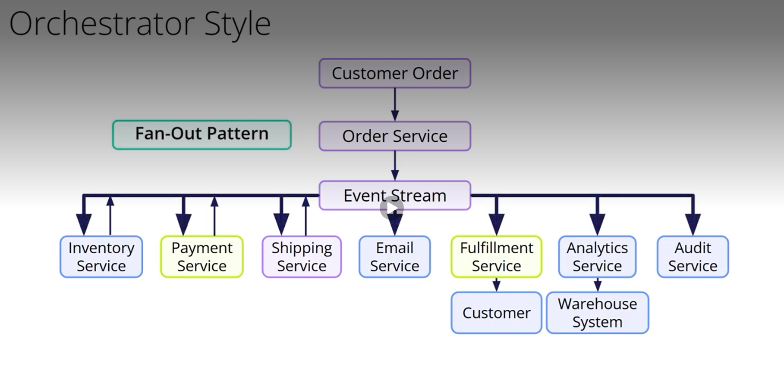

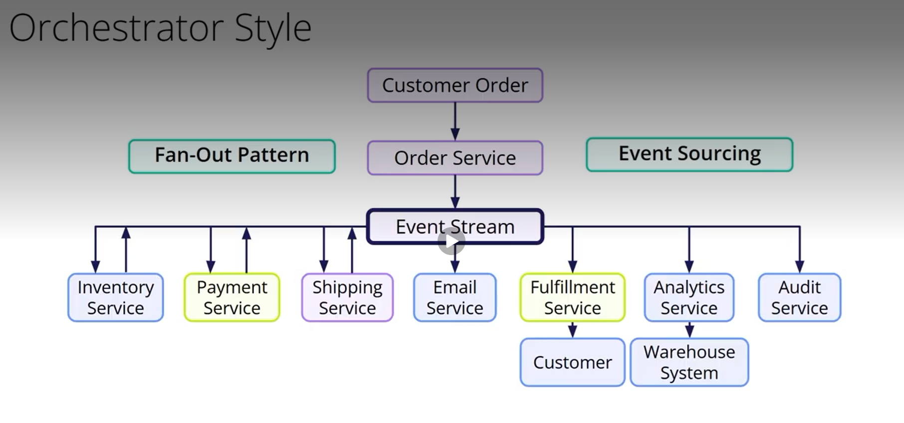

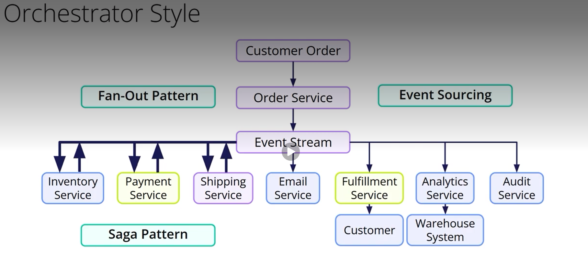

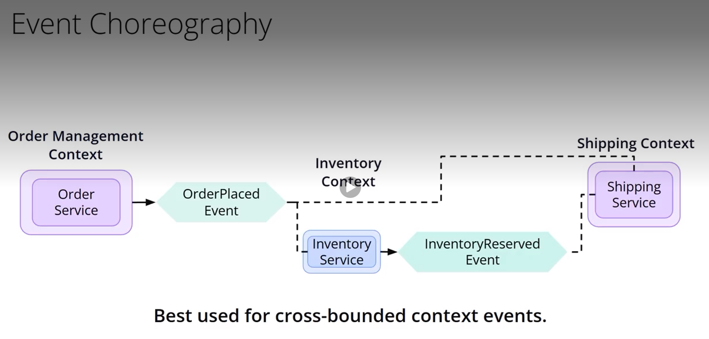

## Microservices and Modular Design Patterns

## Cloud-Native Architectural Patterns

## Data and AI Architecture Patterns

## Distributed Architecture Patterns

## Project: Real-Time Financial Fraud Detection -- Solution Design

