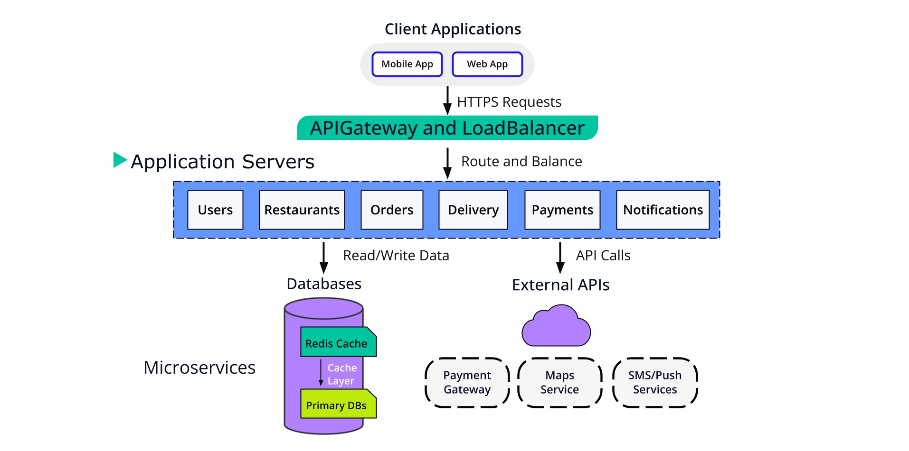

# Software Architecture Patterns

This subdirectory contains my notes and resources of the [Udacity Software Architecture Patterns Course](https://www.udacity.com/course/software-architecture-patterns--cd14601).

I drew the diagrams using [Excalidraw](https://excalidraw.com/).

Table of contents:

- [Software Architecture Patterns](#software-architecture-patterns)
  - [Introduction to Software Architecture](#introduction-to-software-architecture)
    - [What is Software Architecture?](#what-is-software-architecture)
  - [Communicating Software Architecture](#communicating-software-architecture)
  - [Microservices and Modular Design Patterns](#microservices-and-modular-design-patterns)
  - [Cloud-Native Architectural Patterns](#cloud-native-architectural-patterns)
  - [Data and AI Architecture Patterns](#data-and-ai-architecture-patterns)
  - [Distributed Architecture Patterns](#distributed-architecture-patterns)
  - [Project: Real-Time Financial Fraud Detection -- Solution Design](#project-real-time-financial-fraud-detection----solution-design)

## Introduction to Software Architecture

### What is Software Architecture?

You might feel that trying to draw a diagram of a system this early in the course is a bit rough. It's something possibly completely new, and that's okay. This course is about teaching you to think about the shape of your software, which you might not have done before. Let's take a look at a selection. For my familiar app, I picked a food delivery service. Heaven knows I've been a user of them enough times, but let's think about them from an architect perspective now. Here's a very high level answer to our question. This might have been similar to what you mentally modeled your service as. You've got users and drivers, both interacting with the platform. You've got restaurants who serve orders and interact with it in their own way. You've got the payment processor. It sounds reasonable enough. Well, actually, if this is the level of detail you got to, well done. It's a good starting point. But by the end of this course, we'll want to up the ante. You'll go from this to this with more detail, considering how users get to it, data persistence and what functionality you're actually providing to this, with a high level of technical detail, considering how requests might be routed between components, security and performance features like rate limiting. You can download a copy of this in the classroom if you want to see the full detail. Regardless of how you chose to represent your system, what you've done is taken a step forward as an architect to being able to do this better. As long as you've identified some key components, you're right. Let's talk about key characteristics now. First, the bank. Financial institutions are notoriously risk averse. Everyone needs money, and so for them, their top needs are security, ensuring that their systems are safe from bad actors who might not only be after money, but also sensitive financial documents. Availability. With some specific exceptions, nowadays, bank systems are expected to operate with 24/7 availability. Integrity, banks must be able to ensure that their records are correct. The possibility of someone getting money paid or taken from them beyond what they should is a big concern. Next, the video streaming service. These solutions usually operate at scale and serve video content to users globally. What do you think is important for this application? My votes go for performance. There's usually a lot of users for this kind of thing, and a lot of data being thrown around. So much so that Netflix have invested significant resources in improving compression for their services to reduce the volume of data and improve the quality of the video streams. Scalability. Again, with the scale of operation here, we need to make sure that we can scale to meet demand. More users means more replicas, more connections, more load. Ease of use. This might not have been one that you thought of, but these applications have to be easy for everyone to use. I'm not exaggerating when I say that my 3-year-old daughter can navigate a Disney+ menu fluently. You're not going to be digging on a file server for these. They're coming straight to your TV, phone, tablet, with as little friction as possible. Finally, the control system in a car. This is a bit different to the others. The key concerns here relate to a physical system, but it's still a software system, at least in modern cars. Safety. A malfunctioning control system in a vehicle could be absolutely catastrophic. There have to be fail safes that preference safety, over convenience, or performance. Real-time performance. The system must respond to inputs in a timely manner. An input latency between a brake pedal depression and the brakes being applied has risk, not just for the driver, but for other road users or pedestrians. It has to be responsive. Reliability. The solution has to tolerate real world inputs and conditions and continue operating. This could come in a variety of forms, but the end solution must be a reliably available and predictable system for the driver. I hope this first exercise has got your architectural juices flowing. We've got a lot of ground to cover, and these considerations are going to keep coming up. Let's keep things going in the next video.

Introduction to System Architecture Thinking
Learning to diagram and think about software systems is important, even if it feels new or challenging. The first step is modeling high-level components like users, drivers, restaurants, and payment processors in systems such as food delivery apps. This process gets refined over time by adding details like data storage, security, and request routing.

Different types of systems have different needs:

Banking systems need high security, 24/7 availability, and data integrity.
Video streaming services must focus on performance, scalability, and ease of use for users of all ages.
Car control systems prioritize safety, real-time responsiveness, and reliability due to their impact on physical operations.
Recognizing these needs builds foundational skills for designing more complex systems. Getting familiar with these concepts now will make deeper topics easier later in the course.

Food Delivery Service App Architecture - More Detailed

Food Delivery Service App Architecture - Most Detailed

Additional Resources

[Encoding & Quality (Netflix Research](https://research.netflix.com/research-area/video-encoding-and-quality) - further reading on Netflix's compression efforts

## Communicating Software Architecture

## Microservices and Modular Design Patterns

## Cloud-Native Architectural Patterns

## Data and AI Architecture Patterns

## Distributed Architecture Patterns

## Project: Real-Time Financial Fraud Detection -- Solution Design

