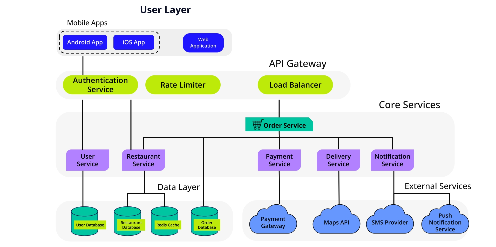

# Software Architecture Patterns

This subdirectory contains my notes and resources of the [Udacity Software Architecture Patterns Course](https://www.udacity.com/course/software-architecture-patterns--cd14601).

I drew the diagrams using [Excalidraw](https://excalidraw.com/).

Table of contents:

- [Software Architecture Patterns](#software-architecture-patterns)
  - [Introduction to Software Architecture](#introduction-to-software-architecture)
    - [What is Software Architecture?](#what-is-software-architecture)
      - [Example: Food delivery service architecture, with increasing detail](#example-food-delivery-service-architecture-with-increasing-detail)
    - [Why Design Our Own Software?](#why-design-our-own-software)
      - [Examples of Software Design](#examples-of-software-design)
    - [Architecture Pattern: Monolith](#architecture-pattern-monolith)
    - [Architecture Pattern: MVC](#architecture-pattern-mvc)
    - [Architecture Pattern: Layered](#architecture-pattern-layered)
    - [Architecture Pattern: Event-Driven](#architecture-pattern-event-driven)
    - [Architecture Archetypes](#architecture-archetypes)
  - [Communicating Software Architecture](#communicating-software-architecture)
  - [Microservices and Modular Design Patterns](#microservices-and-modular-design-patterns)
  - [Cloud-Native Architectural Patterns](#cloud-native-architectural-patterns)
  - [Data and AI Architecture Patterns](#data-and-ai-architecture-patterns)
  - [Distributed Architecture Patterns](#distributed-architecture-patterns)
  - [Project: Real-Time Financial Fraud Detection -- Solution Design](#project-real-time-financial-fraud-detection----solution-design)

## Introduction to Software Architecture

### What is Software Architecture?

- Architectural thinking starts by identifying a system's key components and how they interact.
- We refine a high-level model by adding detail progressively:
  - Identify the actors and external systems: a food delivery platform connects users, drivers, restaurants, and a payment processor.
  - Describe how users access the platform, the functionality it provides, and how it persists data.
  - Specify how requests move between components and how security and performance features, such as rate limiting, work.
- We prioritize architectural characteristics according to the system's needs; for instance:
  - **Banking systems:**
    - **Security:** Protect money and sensitive financial information from unauthorized access.
    - **Availability:** Support around-the-clock operation, subject to specific exceptions.
    - **Integrity:** Keep records correct so payments and withdrawals affect accounts by the intended amounts.
  - **Video streaming services:**
    - **Performance:** Deliver large volumes of video to many users globally. Compression can reduce data volume and improve stream quality; Netflix invests in this area.
    - **Scalability:** Accommodate growing demand, including more replicas, connections, and load.
    - **Ease of use:** Make content easy to find and play across televisions, phones, and tablets, including for young users.
  - **Car control systems:**
    - **Safety:** Use fail-safes that prioritize safety over convenience or performance because malfunctions can cause physical harm.
    - **Real-time responsiveness:** Respond promptly to inputs such as brake-pedal presses; delays can endanger drivers and other road users.
    - **Reliability:** Tolerate real-world inputs and conditions while remaining available and predictable.

#### Example: Food delivery service architecture, with increasing detail

Some components:

- **API gateway:** An entry point for client requests to the platform's API (Application Programming Interface).
  - Routes requests to the appropriate backend service, such as orders or restaurants, and can centralize authentication, logging, and rate limiting.
  - Example: Route `POST /orders` from the customer app to the order service. The service still checks business rules, such as whether the customer may access a particular order.
- **Load balancer:** Distributes incoming traffic across healthy server or service instances to spread work and maintain availability.
  - Example: Distribute order requests among three instances of the order service and stop sending requests to an instance that fails health checks.
  - A gateway manages API routes and policies; a load balancer selects an instance to handle traffic. One product can perform both roles, and their placement depends on the architecture.
- **Payment gateway:** Securely exchanges payment information and authorization requests between the application and payment-processing systems.
  - Example: During checkout, submit a payment request and receive its status before advancing the order's payment workflow.
  - A payment provider may bundle gateway and processing functions. The platform's payment service handles its own business rules and records the payment outcome.
- **Redis cache:** A fast, in-memory store used here to keep temporary copies of frequently requested data and reduce database reads.
  - Example: Check Redis for a restaurant menu; on a cache miss, read it from the database and cache the result.
  - Use expiration through a TTL (Time To Live) and update or invalidate cached entries when necessary. Cached data can become stale; the durable database remains the source of truth in this design.
- **Rate limiter:** Restricts how many requests a caller can make within a time period to control abuse and protect system capacity.
  - Example: Allow an illustrative limit of 100 restaurant-search requests per user per minute, then reject excess requests, commonly with HTTP (Hypertext Transfer Protocol) status `429 Too Many Requests`.
  - It can run in the API gateway or a service and use shared Redis counters so multiple instances enforce a common limit.
- **Core services:** Implement the platform's main business capabilities and rules.
  - Examples include managing users, restaurant menus, orders, payments, and driver assignments.
  - They coordinate state changes and integrations: an order service can check availability, request payment, and arrange delivery. These capabilities may be modules in one application or separately deployed services.
- **Data layer:** Stores and retrieves application data through databases and the code that accesses them.
  - Example: Persist customers, restaurants, orders, and payment references so records survive application restarts.
  - Its design determines how data is queried, kept consistent, and recovered. Cache use complements durable storage.
- **Maps API:** An external interface for mapping capabilities, such as displaying maps, converting addresses to coordinates, or calculating routes and travel times.
  - Example: Locate a delivery address and estimate a driver's journey from the restaurant to the customer.
  - Live driver tracking also requires the driver's app to send location updates; route calculations alone do not supply those updates.
- **Push notification service:** Sends messages from the backend to users' devices through platform delivery systems, including when the app is not open on screen.
  - Example: Notify the customer that an order was accepted or that the driver is approaching.
  - Providers such as Firebase Cloud Messaging deliver messages to registered app instances. Keep order status in the backend so opening the app retrieves the current state independently of a notification.

Component references:

- [API gateways and load balancing (Apache APISIX)](https://apisix.apache.org/learning-center/api-gateway-vs-load-balancer/)
- [Payment gateways (Stripe)](https://stripe.com/resources/more/payment-gateways-101)
- [Redis caching](https://github.com/redis/docs/blob/main/content/develop/use-cases/cache-aside/go/_index.md)
- [Redis rate limiting](https://github.com/redis/docs/blob/main/content/commands/incr.md)
- [Google Maps documentation](https://developers.google.com/maps/documentation/)
- [Firebase Cloud Messaging architecture](https://firebase.google.com/docs/cloud-messaging/fcm-architecture)

Additional resource: [Encoding & Quality (Netflix Research)](https://research.netflix.com/research-area/video-encoding-and-quality) explains Netflix's work on video encoding and quality.

### Why Design Our Own Software?

- Choose an architecture that fits current requirements and can evolve as needs change.
- **Twitter example:** Traffic during the 2010 World Cup exposed scaling limits that adding servers could no longer solve economically. Twitter redesigned its stack and reorganized its engineering teams.
  - Its original design favored a quick launch; needing a redesign later did not make that initial trade-off wrong.
  - **Conway's law:** Systems tend to reflect team structure; architectural changes can also drive team restructuring.
- Make trade-offs deliberately: prioritize reliability for safety-critical systems, rapid iteration for early products, and compatibility and data integrity for legacy rewrites.

Further reading: [New Tweets per second record, and how!](https://blog.x.com/engineering/en_us/a/2013/new-tweets-per-second-record-and-how).

#### Examples of Software Design

- **Nuclear power plant control system:** Prioritize stability, safety, and timely responses; accept higher operating costs to maintain these characteristics.
- **Growing social media app:** Prioritize rapid development, adaptability, and a responsive interface; some reduction in reliability may be acceptable initially.
- **Government agency's legacy system rewrite:** Prioritize backward compatibility and reliability to preserve internal workflows; accept greater development effort.
- Balance competing characteristics according to business needs. Improving one does not always require sacrificing another, but some compromises are necessary.

### Architecture Pattern: Monolith

### Architecture Pattern: MVC

### Architecture Pattern: Layered

### Architecture Pattern: Event-Driven

### Architecture Archetypes

## Communicating Software Architecture

## Microservices and Modular Design Patterns

## Cloud-Native Architectural Patterns

## Data and AI Architecture Patterns

## Distributed Architecture Patterns

## Project: Real-Time Financial Fraud Detection -- Solution Design

